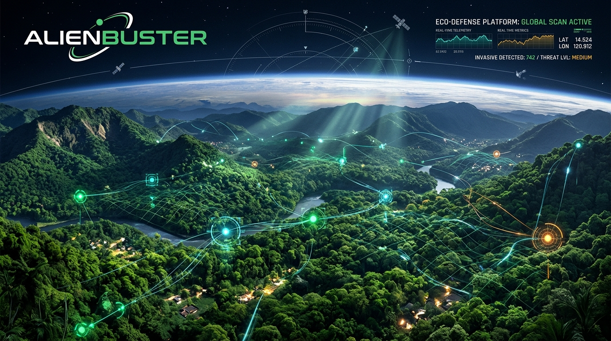

<div align="center">



# 🛰️ AlienBuster

### AI-Powered Early Warning System & Nature-Forward Operations Console for Invasive Species Detection

[](https://github.com/JoanathanPS/alienbuster)
[](https://canva.link/0pmea91ua4h69jf)
[](https://alienbuster.joanathan.in)
[](https://opensource.org/licenses/MIT)

<br />

**Crowdsourced ground truth + remote sensing $\rightarrow$ decision-ready incidents.**  
*Detect ecological bio-threats 6–12 months earlier than traditional surveys.*

---

</div>

## 📌 Project Links & Resources

- 🎨 **Canva Presentation / Pitch Deck:** [canva.link/0pmea91ua4h69jf](https://canva.link/0pmea91ua4h69jf)
- 💻 **GitHub Repository:** [github.com/JoanathanPS/alienbuster](https://github.com/JoanathanPS/alienbuster)
- 🌐 **Live Web Application:** [alienbuster.joanathan.in](https://alienbuster.joanathan.in)

---

## 🌿 About AlienBuster

**AlienBuster** is an eco-defense intelligence platform and nature-forward operations console designed to protect fragile biodiversity and native ecosystems. By fusing BioCLIP machine learning vision, satellite remote sensing change detection, and clustered crowdsourced field observations, AlienBuster turns raw ecological data into clear, explainable, and actionable threat incidents.

### Key Capabilities

- **🛰️ Early Warning Signals:** Spot invasive species clusters 6–12 months prior to conventional surveys.
- **🔍 Multi-Modal Bio-Intelligence:** AI species identification powered by BioCLIP integrated with satellite telemetry.
- **🗺️ Geospatial Threat Mapping:** Interactive heatmaps, marker clustering, and geographic incident tracking with Leaflet.
- **⚡ Calm Signals, Rapid Response:** Triage priority levels, review crowdsourced sightings, and dispatch field response teams.

---

## 🧠 AI Species Identification & Vision Model

The system uses a flexible, multi-mode architecture for identifying invasive species from user-submitted photos:

| Mode | Configuration | Description |
| :--- | :--- | :--- |
| **Heuristic Engine** *(Default)* | `VISION_MODEL_MODE=heuristic` | **Instant, zero-download, zero-dependency.** Evaluates image color spectra, vegetation index, and taxonomy matching. Runs out of the box with no GPU or gigabyte-sized model weights. |
| **Hugging Face API** *(Cloud)* | `VISION_MODEL_MODE=huggingface`<br>`HUGGINGFACE_API_KEY=hf_...` | Uses HuggingFace Serverless Inference API for `imageomics/bioclip`. No local downloads or GPU required. |
| **Gemini Vision API** *(Cloud)* | `VISION_MODEL_MODE=gemini`<br>`GEMINI_API_KEY=...` | Cloud multimodal identification with reasoning explanations. |
| **Local PyTorch** *(Optional)* | `VISION_MODEL_MODE=local_torch` | Runs local PyTorch & `open_clip` weights (requires `torch` and GPU or local checkpoint). |

> [!NOTE]
> **No local model weights are required!** You do **not** need to download multi-gigabyte `.bin` model files. Out-of-the-box, the backend uses the zero-download heuristic engine or cloud inference endpoints.

---

## 🛠️ Environment Variables Configuration

All configuration is consolidated into a single template: [`.env.example`](file:///.env.example).

To configure your environment:
```bash
# Copy the template to .env
cp .env.example .env
```

### Key Variables
- **`VITE_API_BASE`**: URL of the Python FastAPI backend (`http://127.0.0.1:8000`).
- **`VITE_SUPABASE_URL`** & **`VITE_SUPABASE_PUBLISHABLE_KEY`**: Supabase client connection (safe to expose to browser).
- **`SUPABASE_SERVICE_ROLE_KEY`**: Secret Supabase key for backend (optional; backend defaults to local SQLite if omitted).
- **`VISION_MODEL_MODE`**: Set to `heuristic` (default) or `huggingface`.

---

## 🚀 Running Locally

### 1. Frontend Setup
```bash
npm install
npm run dev
# Vite runs at http://localhost:8080
```

### 2. Backend Setup
```bash
cd backend
pip install -r requirements.txt
python -m uvicorn backend.main:app --reload --port 8000
```

### 3. One-Click Launcher (Windows)
Run the bundled launcher script to start both services simultaneously:
```cmd
run_app.bat
```

---

## 🧪 Testing with Playwright & Vitest

```bash
# Run unit & component tests
npm run test

# Run End-to-End browser tests (Playwright)
npx playwright test
```

---

## 📄 License

This project is licensed under the [MIT License](LICENSE).
